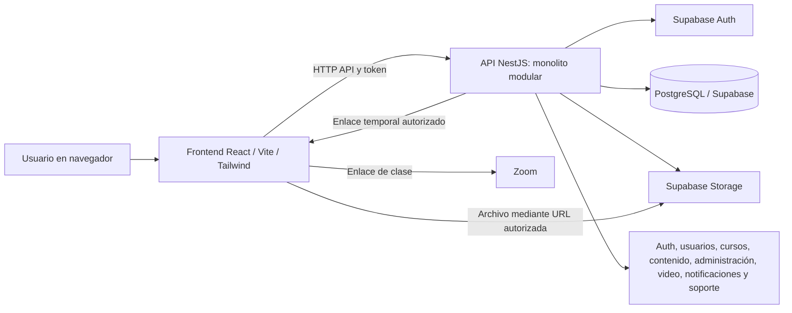
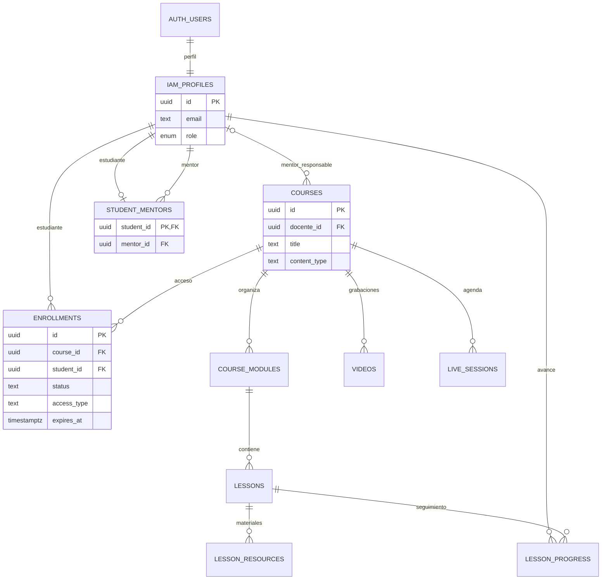

# Arquitectura y modelo de datos de Traction

Fecha de revisión: 6 de noviembre de 2026.

## Dictamen

**Estado del criterio: parcialmente completado, pendiente de aprobación formal y validación del entorno desplegado.**

El código y las migraciones implementan una arquitectura modular, múltiples cursos, múltiples cuentas de mentores, cuatro roles y acceso por matrícula. El stack está identificado en los manifiestos. Esta revisión no encontró un acta, firma o registro de aprobación de arquitectura y modelo. Los diagramas de este documento se elaboraron durante la revisión y se entregan para revisión; no se consideran aprobados.

“Programa” se interpreta aquí como un registro de `courses.courses`, tal como lo presenta el frontend. No existe una entidad independiente que agrupe varios cursos en un programa. Si ese es el significado requerido, hace falta ampliar el modelo.

## Cumplimiento y límites

| Criterio | Evidencia | Estado |
| --- | --- | --- |
| Arquitectura definida | API NestJS modular, frontend React y servicios Supabase | Implementada en código |
| Diagrama de arquitectura aprobado | Diagrama propuesto abajo; sin constancia de aprobación encontrada | Pendiente |
| Modelo de datos definido | Migraciones SQL versionadas con tablas y claves foráneas | Implementado en migraciones |
| Modelo de datos aprobado | Sin constancia de aprobación encontrada | Pendiente |
| Múltiples programas/cursos | `courses.courses` y matrículas por curso/estudiante | Sí, si programa equivale a curso |
| Múltiples mentores | Perfiles con rol mentor y asignación por `docente_id` | Sí a nivel de plataforma; un responsable por curso |
| Mentoría personal | `iam.student_mentors` | Un mentor por estudiante; un mentor puede atender a varios estudiantes |
| Roles | `admin`, `mentor`, `estudiante`, `soporte` | Cuatro roles; uno por usuario |
| Niveles de acceso | `access_type`, `status`, `expires_at` y vista `active_enrollments` | Completo, contenido o clases en vivo |
| Stack definido | `package.json` del frontend y de la API | Sí |

Agregar cursos, estudiantes, mentores y matrículas dentro de estas reglas no exige rediseñar el esquema. Incorporar varios mentores al mismo curso, varios mentores personales al mismo estudiante, roles simultáneos o permisos configurables requiere cambios. Los roles son un enum y un tipo de TypeScript; no existe un sistema genérico de roles y permisos administrables.

## Stack observado

| Capa | Tecnología |
| --- | --- |
| Interfaz activa revisada | React 19, JavaScript/JSX, Vite 8, Tailwind CSS 4, Lucide React |
| API | TypeScript, NestJS 12 sobre Express, class-validator y class-transformer |
| Datos | PostgreSQL mediante Supabase, migraciones SQL |
| Identidad | Supabase Auth y autenticación JWT en la API |
| Archivos | Supabase Storage; archivos privados y enlaces temporales autorizados |
| Clases | Agenda y enlaces de Zoom; grabaciones subidas manualmente |
| Verificación | Vitest en API; Node test runner y pruebas DOM en frontend; Oxlint |
| Entorno local | Node.js >=22, npm, Supabase CLI y Docker para Supabase local |

Las versiones indicadas corresponden a las declaraciones de los manifiestos; no certifican las versiones instaladas en producción. El repositorio backend también incluye `apps/web`; la interfaz activa del IDE es el repositorio separado `traction-frontend`.

## Diagrama de arquitectura propuesto

La API comprueba identidad, rol y alcance sobre el recurso: matrícula vigente, modalidad de acceso o asignación del mentor. La clave de servicio de Supabase pertenece al servidor. Las migraciones restringen el acceso directo de roles públicos a los datos de negocio; RLS no sustituye la autorización de la API que usa el cliente de servicio.

## Modelo relacional principal propuesto

Diagrama resumido de las relaciones centrales; no es un inventario exhaustivo de columnas, restricciones ni tablas auxiliares. Los nombres son los del esquema SQL.

`IAM_PROFILES` representa `iam.profiles`; las entidades académicas representan tablas del schema `courses`, y videos/sesiones pertenecen a `video`. La unicidad de `(course_id, student_id)` evita matrículas duplicadas. Las notas, preguntas, reanudación del estudio, avisos, lecturas de notificaciones y tickets complementan este núcleo.

## Matriz de acceso académico

| Modalidad de matrícula | Lecciones y archivos | Grabaciones | Clases en vivo |
| --- | --- | --- | --- |
| `full` | Sí | Sí | Sí |
| `content` | Sí | Sí | No |
| `live` | No | No | Sí |

La matrícula debe estar activa y no vencida. `courses.active_enrollments` calcula ese alcance usando la hora de la base. Rol y modalidad son conceptos diferentes: el rol define funciones del usuario y la matrícula delimita su acceso a cada curso.

## Evidencias del repositorio

Backend revisado en `C:/Users/jumbo/Downloads/traction`:

- `apps/api/src/app.module.ts`: módulos registrados de la API.
- `apps/api/src/modules/auth/auth.types.ts`: cuatro roles actuales.
- `supabase/migrations/20261015224142_init_auth_courses.sql`: perfiles, cursos y matrículas.
- `supabase/migrations/20261015230319_course_docente.sql`: mentor responsable por curso.
- `supabase/migrations/20261018140000_four_roles.sql`: actualización de roles y acceso a schemas.
- `supabase/migrations/20261028000300_administration_access.sql`: modalidades y vencimiento de acceso.
- `supabase/migrations/20261029000100_student_mentor.sql`: mentor personal por estudiante.
- `docs/administration.md`: reglas administrativas y extensiones pendientes.

Frontend revisado: `package.json`, `src/services/api.js`, `src/services/access.js` y README. La presencia de una pantalla no demuestra una funcionalidad de backend: por ejemplo, `CommunityView.jsx` maneja publicaciones y reacciones en estado local; no certifica una comunidad persistente implementada.

## Validación realizada y cierre pendiente

La suite de la API pasó durante esta revisión: **20 archivos y 175 pruebas aprobadas**. Es una comprobación automatizada local; no acredita por sí sola migraciones aplicadas, seguridad integral ni funcionamiento en producción. No se consultó ni modificó la base desplegada.

Para cerrar el criterio:

1. Confirmar que programa equivale a curso y aceptar las cardinalidades actuales de mentores y roles.
2. Revisar los diagramas y registrar responsable, fecha, versión y decisión de aprobación.
3. Confirmar las migraciones aplicadas en el entorno objetivo y verificar allí los accesos con cuentas de cada rol y modalidad.

Texto sugerido para el informe actual:

> Traction implementa un monolito modular en NestJS, una interfaz React y una base PostgreSQL sobre Supabase. El modelo permite múltiples cursos, cuentas de mentores y matrículas, con cuatro roles y tres modalidades de acceso por curso, además de suspensión y vencimiento. Cada curso admite un mentor responsable, cada estudiante un mentor personal y cada usuario un rol. El stack está definido y las pruebas locales de la API son satisfactorias. La aprobación formal de los diagramas y la validación del entorno desplegado permanecen pendientes.
